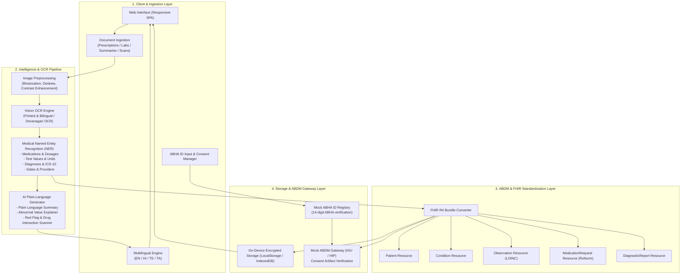

# 🩺 CareCompass: Medical Record Intelligence, Unified Health Profile & ABDM Architecture

## 1. Executive Summary & Problem Statement
In India and globally, patients accumulate fragmented paper-based prescriptions, handwritten clinical notes, diagnostic lab printouts, and discharge summaries across multiple hospital visits and diagnostic centers. 
- **Complexity**: Patients struggle to decipher medical jargon, abbreviations (e.g., *OD, BD, PRN, HbA1c, LFT*), and abnormal biomarker values.
- **Fragmented History**: Doctors lack a single chronological timeline of past illnesses, drug allergies, and active medications.
- **Language Barriers**: 80%+ of Indian citizens communicate in regional languages (Hindi, Telugu, Tamil, Bengali, etc.), while medical documents are written predominantly in English.

**CareCompass** bridges this divide by providing:
1. **Medical Record Intelligence & OCR**: Ingesting prescriptions, lab reports, and discharge summaries with entity extraction (medications, dosages, test values, diagnoses, and dates).
2. **AI Health Summary in Simple Language**: Translating clinical findings into empathetic, actionable plain language with everyday analogies.
3. **Unified Health Profile & Longitudinal Timeline**: Consolidating separate records into a single patient timeline with active conditions and drug schedules.
4. **Multilingual Regional Support**: Full interface and AI summaries available in English, Hindi (हिन्दी), Telugu (తెలుగు), and Tamil (தமிழ்).
5. **ABDM / ABHA & FHIR R4 Readiness**: Native alignment with Ayushman Bharat Digital Mission (ABDM) standards, mock ABHA ID linking, and FHIR R4-compliant JSON bundle generation.

---

## 2. End-to-End System Architecture



---

## 3. Data Pipeline & Component Breakdown

### 3.1 Document Ingestion & Vision OCR
- **Inputs**: Image captures (PNG, JPG, HEIC), digitized PDFs of hospital discharge summaries, clinical lab reports, handwritten or bilingual doctor prescriptions.
- **Preprocessing**: Contrast enhancement, deskewing, noise reduction, and zone segmentation (Header, Rx section, Diagnostic table, Doctor signature).
- **OCR Engine**: Multi-lingual text recognition supporting Latin script, Devanagari (Hindi), and regional scripts.

### 3.2 Medical NER & Intelligence Extraction
Extracts structured medical entities according to standardized clinical taxonomies:
| Entity Category | Extracted Data Fields | Standard Coding System |
|-----------------|----------------------|------------------------|
| **Medications** | Name, Strength, Form, Frequency (*OD, BD, TID*), Duration | RxNorm / SNOMED CT |
| **Test Values** | Biomarker name, Numeric value, Unit, Reference range, Flag (*High/Low/Normal*) | LOINC |
| **Diagnoses**   | Primary diagnosis, Comorbidities, Status (*Active/Resolved*) | ICD-10 / SNOMED CT |
| **Encounter**   | Facility name, Attending clinician, Encounter date | ABDM Facility Registry (HFR) |

### 3.3 AI Plain-Language Summarization & Multilingual Generation
- **Empathetic Explainer**: Converts intimidating terms into straightforward concepts.
  - *Example*: "Dyslipidemia with elevated LDL (148 mg/dL)" $\rightarrow$ "Your 'bad cholesterol' is higher than recommended. Think of it like mineral buildup in home water pipes—over time it restricts healthy blood flow to your heart."
- **Multilingual Support**: Uses regional localization models for Hindi, Telugu, and Tamil so patients and family members can read medical findings in their native language.

### 3.4 ABDM Readiness & FHIR R4 Schema
All extracted records map directly into **HL7 FHIR R4 Bundle** (`DiagnosticReport`, `MedicationRequest`, `Observation`, `Condition`, `Patient`).

#### Example FHIR R4 JSON Schema (DiagnosticReport & Observation):
```json
{
  "resourceType": "Bundle",
  "type": "collection",
  "identifier": {
    "system": "https://healthid.ndhm.gov.in",
    "value": "91-8472-9102-3841"
  },
  "entry": [
    {
      "resource": {
        "resourceType": "Patient",
        "id": "pat-01",
        "name": [{ "text": "Kavita Sharma" }],
        "gender": "female",
        "birthDate": "1984-06-12",
        "identifier": [
          {
            "system": "https://healthid.ndhm.gov.in",
            "value": "91-8472-9102-3841"
          }
        ]
      }
    },
    {
      "resource": {
        "resourceType": "Observation",
        "id": "obs-hba1c",
        "status": "final",
        "code": {
          "coding": [{
            "system": "http://loinc.org",
            "code": "4548-4",
            "display": "Hemoglobin A1c"
          }]
        },
        "valueQuantity": {
          "value": 7.8,
          "unit": "%",
          "system": "http://unitsofmeasure.org"
        },
        "interpretation": [{
          "coding": [{
            "system": "http://terminology.hl7.org/CodeSystem/v3-ObservationInterpretation",
            "code": "H",
            "display": "High"
          }]
        }]
      }
    },
    {
      "resource": {
        "resourceType": "MedicationRequest",
        "id": "med-metformin",
        "status": "active",
        "intent": "order",
        "medicationCodeableConcept": {
          "text": "Metformin 500mg"
        },
        "dosageInstruction": [{
          "text": "Twice daily after meals (BD)"
        }]
      }
    }
  ]
}
```

---

## 4. Hackathon Presentation Slide Deck

### Slide 1: Title & Vision
- **CareCompass**: India's First Multilingual AI Health Copilot with Medical OCR & ABDM Readiness.
- *Mission*: Making complex healthcare records understandable, unified, and accessible to every citizen in their native language.

### Slide 2: The Core Problem
- 1.4 Billion citizens, 100,000+ hospitals, yet medical data remains locked in handwritten prescriptions and paper files.
- High patient anxiety: Inability to interpret lab results and medical abbreviations.
- Language barrier: Medical reports are in English, while millions prefer Hindi, Telugu, or Tamil.

### Slide 3: CareCompass 4-Pillar Solution
1. **OCR & Record Intelligence**: Drag-and-drop prescriptions, labs, and discharge summaries; instantly extract medicines, lab values, and diagnoses.
2. **AI Plain-Language Translation**: Jargon-free explanations and everyday analogies with lifestyle insights.
3. **Unified Health Timeline**: Chronological patient journey tracking active conditions and medications.
4. **ABDM / ABHA Integration**: 1-click ABHA ID link, consent management, and standard FHIR R4 export.

### Slide 4: ABDM Alignment & Standards
- Compliance with National Health Authority (NHA) M2 & M3 standards.
- Seamless conversion to FHIR R4 JSON bundles compatible with national Health Information Exchanges (HIE-CM).

### Slide 5: Real-World Impact & Safety First
- Multi-tier emergency detection stops medical harm before it starts (chest pain, stroke signs route instantly to emergency services).
- Private by design: all medical intelligence processed client-side without storing personal health records on third-party ad networks.
