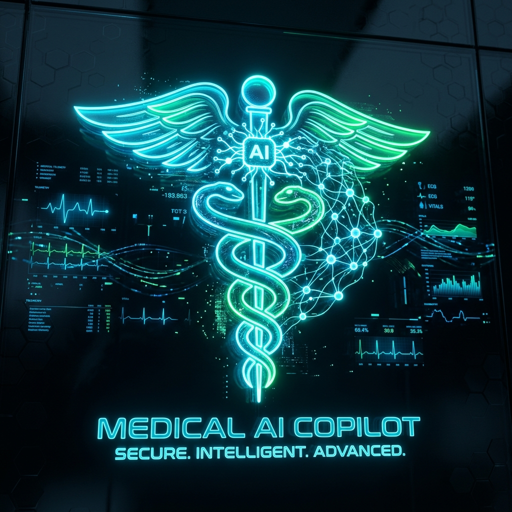

# 🩺 PulseAI — Next-Gen AI Healthcare Copilot & Clinical Triage

> **Hackathon Submission Project** | Built with Vanilla HTML5, Modern CSS3 & JavaScript | Zero-Config Deployment on Vercel



**PulseAI** is an advanced, AI-powered healthcare copilot designed to bridge the gap between patient self-triage and physician workflow. Built with high-performance Vanilla Web technologies (HTML, CSS, JavaScript), it combines real-time biometric telemetry visualization, clinical symptom stratification, multimodal lab report analysis, drug-interaction safety checking, and ambient AI clinical scribing.

---

## 🚀 One-Click Deploy to Vercel

Deploy this project on Vercel with zero configuration:

[](https://vercel.com/new)

### Option A: Via Vercel CLI
```bash
npm i -g vercel
vercel
```

### Option B: Via GitHub & Vercel Dashboard
1. Push this repository to GitHub.
2. Go to [vercel.com](https://vercel.com) and click **"Add New Project"**.
3. Select this repository and click **Deploy**. Vercel automatically serves `index.html` as a fast static single-page application with edge CDN caching.

---

## 🌟 Key Hackathon Innovations & Core Features

### 1. 🤖 Intelligent Clinical Triage & Differential Diagnosis Copilot
- **Emergency Severity Index (ESI) Engine**: Stratifies cases from Level 1 (Resuscitation) to Level 5 (Non-urgent).
- **Dual-Persona Switcher**:
  - **Patient Mode**: Empathetic, plain-English explanations, red-flag warning signs, and practical action advice.
  - **Clinician / MD Mode**: Evidence-based differential diagnosis, ICD-10 code suggestions, and diagnostic workup recommendations.
  - **Offline Resilience + Gemini Cloud Option**: Operates seamlessly out-of-the-box with a comprehensive built-in clinical rule engine (zero API key required for judge evaluation), with an optional settings field to plug in a Google Gemini 1.5 / 2.0 API key for live LLM responses.

### 2. 🧪 AI Lab Report & Biomarker Vision Analyzer
- **Multimodal Document Ingestion**: Drag & drop blood test reports, pathology sheets, and imaging scans.
- **Biomarker Range Detection**: Instant extraction and classification of normal vs abnormal biomarkers with visual risk indicators.
- **Preloaded Authentic Panels**: Includes Complete Blood Count (CBC), Advanced Lipid Panel, and Comprehensive Metabolic Panel (CMP) for instant live demonstration.

### 3. 💊 Multi-Drug Interaction & Rx Safety Checker
- Evaluates multi-medication combinations for life-threatening contraindications, CYP450 enzyme conflicts, and synergistic toxicity (e.g. Warfarin + Aspirin + NSAIDs).
- Provides FDA alert warnings and food/dietary interactions (e.g. Grapefruit, Vitamin K, Potassium).
- One-click **"Load Dangerous Combo"** preset for judges.

### 4. 🎙️ Ambient AI Clinical Scribe (Doctor SOAP Notes)
- Uses the browser's native **Web Speech API** for ambient doctor-patient conversation listening.
- Automatically synthesizes unstructured dialogue into clinical **SOAP Notes** (Subjective, Objective, Assessment, Plan) with ICD-10 billing code suggestions.
- Includes preloaded templates for Cardiology and Neurology consultations.
- One-click copy to clipboard for EHR integration.

### 5. 💓 Live Animated ECG Monitor & Biometric Telemetry
- Real-time 60 FPS HTML5 Canvas oscilloscope simulating continuous cardiac Lead II P-Q-R-S-T waveforms.
- Switchable cardiac rhythms: **Normal Sinus (72 BPM)**, **Sinus Tachycardia (128 BPM)**, and **Frequent PVC Arrhythmia**.
- Web Audio API heartbeat acoustic pip tone generator (toggleable 🔊).

### 6. 📄 Clinical Handover Summary (Export / Print Ready)
- Automatically compiles patient vitals, telemetry status, chief complaints, differential diagnoses, and AI action items.
- Formatted with `@media print` styling for clean PDF export and hospital handover.

### 7. 🚨 Rapid Emergency SOS Dispatch Protocol
- Immediate one-tap modal featuring simulated GPS coordinates, nearest ER facility wait times, and direct 911 / emergency dialing.

---

## ⚡ 2-Minute Hackathon Demo Script for Judges

1. **Telemetry & Live Vitals**:
   - Notice the glowing cyan Lead II ECG wave in the top banner.
   - Click **"Tachycardia"** or **"Arrhythmia"** to watch the waveform and vitals react in real-time. Click 🔊 to hear the acoustic cardiac pip.
2. **Clinical AI Triage**:
   - Click the prompt chip: **"🚨 Chest Pressure & Arm Pain"**.
   - Observe the real-time clinical evaluation, the Urgency Gauge climbing to **94 (Emergency)**, and the Differential Diagnosis list updating with ICD-10 codes.
   - Switch between **Patient Mode** and **Clinician / MD** in the top navigation to see the tone and technical depth dynamically change!
3. **Lab Vision Analyzer**:
   - Click the **"Lab & Report Vision Analyzer"** tab.
   - Click **"Advanced Lipid Cardio Panel"** to see instant biomarker breakdown (LDL 178 mg/dL flagged critical high) and AI action plan.
4. **Drug Safety Checker**:
   - Switch to the **"Drug Interaction & Rx Safety"** tab.
   - Click **"Load Dangerous Combo Preset"** (Warfarin + Aspirin + Ibuprofen) and click **"Run Interaction Analysis"** to see critical hemorrhage risk warnings.
5. **Ambient Clinical Scribe**:
   - Switch to the **"Ambient AI Clinical Scribe"** tab.
   - Click **"Preset: Cardiology SOAP"** and view the structured Subjective, Objective, Assessment, and Plan note. Click **"Copy Note"**.
6. **Handover Packet**:
   - Switch to **"Doctor Handover Packet"** and click **"Print / Save PDF"** to preview the hospital handover packet.

---

## 📂 Project Structure

```
health-care-copilot/
├── assets/
│   └── hero-badge.jpg         # Holographic Medical AI Copilot Badge
├── index.html                 # Semantic HTML5 Application Structure
├── style.css                  # Cyber-Medical Design System (Dark Glassmorphic UI)
├── app.js                     # Application Core Logic & Triage Engine
├── medical-data.js            # Clinical Knowledge Base, Presets & Drug Interactions
├── vercel.json                # Vercel Deployment & Caching Config
├── package.json               # Project Metadata & Preview Scripts
└── README.md                  # Hackathon Documentation
```

---

## 💻 Local Development

To run the application locally:

```bash
# Using any static server (e.g. serve, Live Server, or Python):
npx serve .
# Or with Python:
python -m http.server 3000
```

Open [http://localhost:3000](http://localhost:3000) in any modern web browser.

---

## 🛡️ Medical & Ethical Disclaimer

*PulseAI is a clinical decision support prototype developed for hackathons, educational demonstrations, and conceptual evaluation. It is not intended for primary clinical diagnosis or to replace professional medical advice, emergency care, or licensed physician assessment.*
